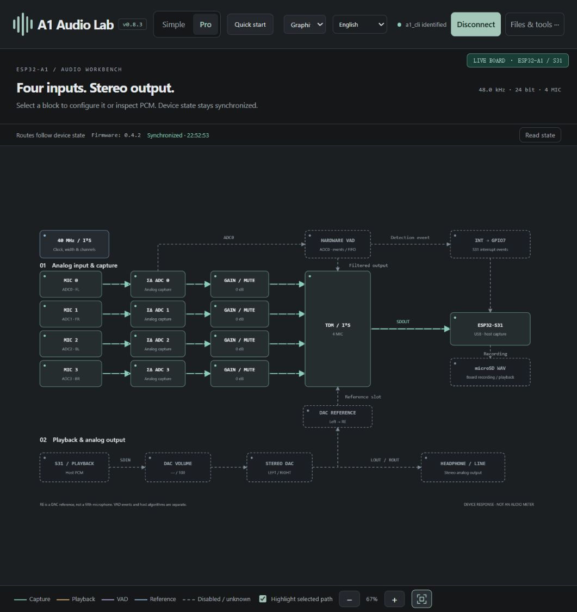
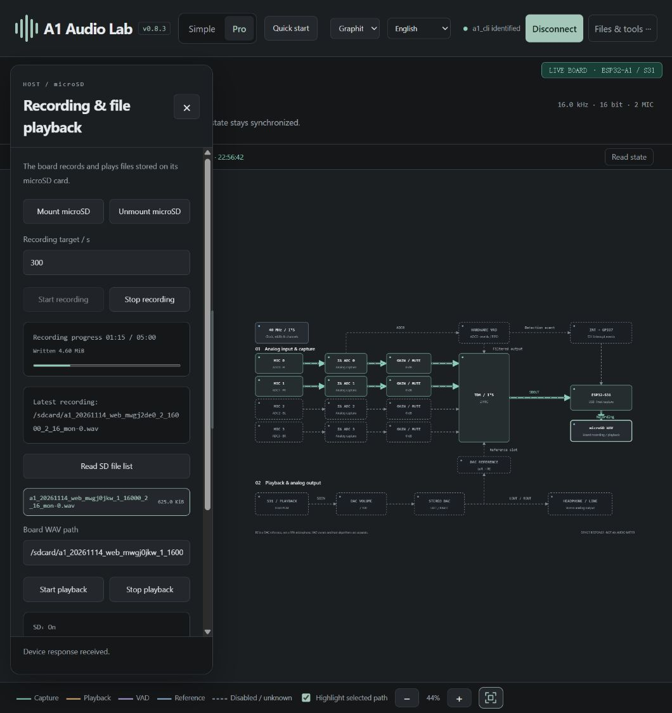
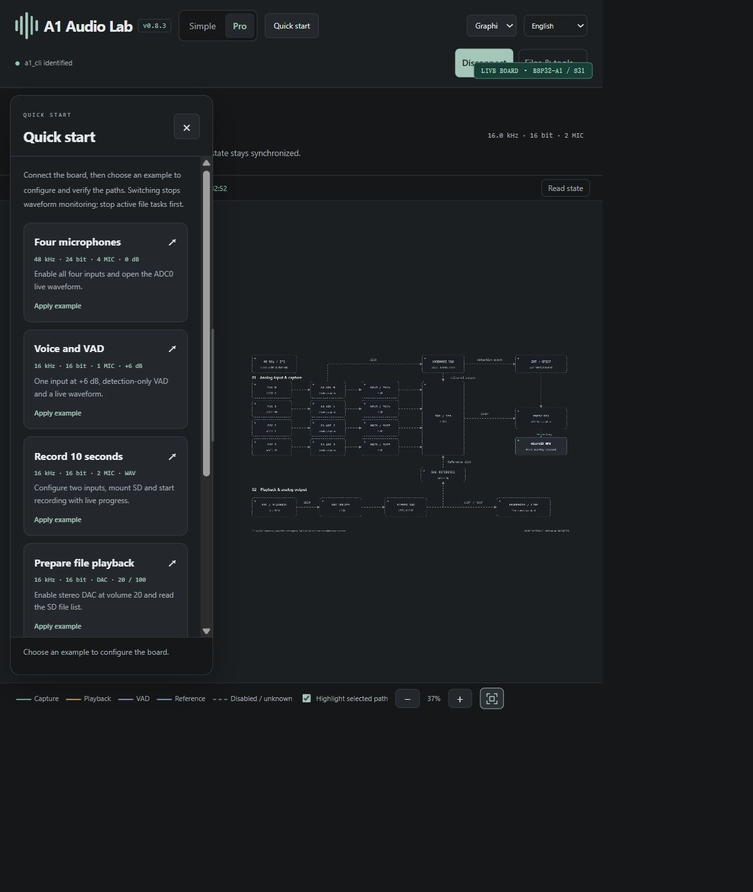
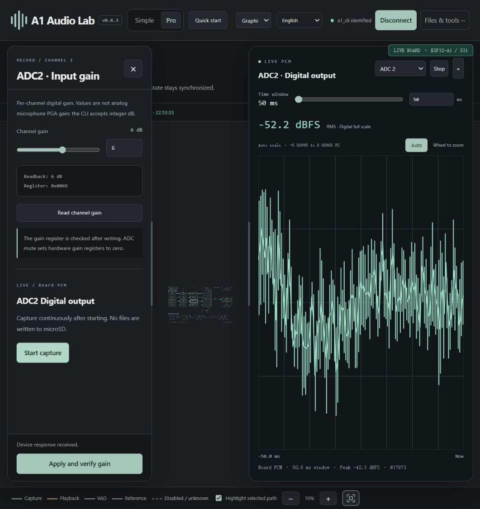
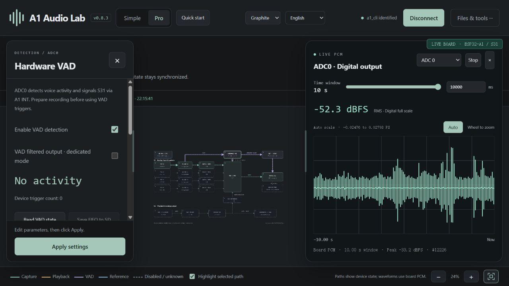
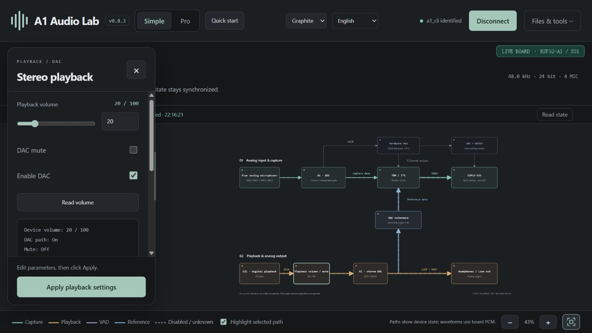
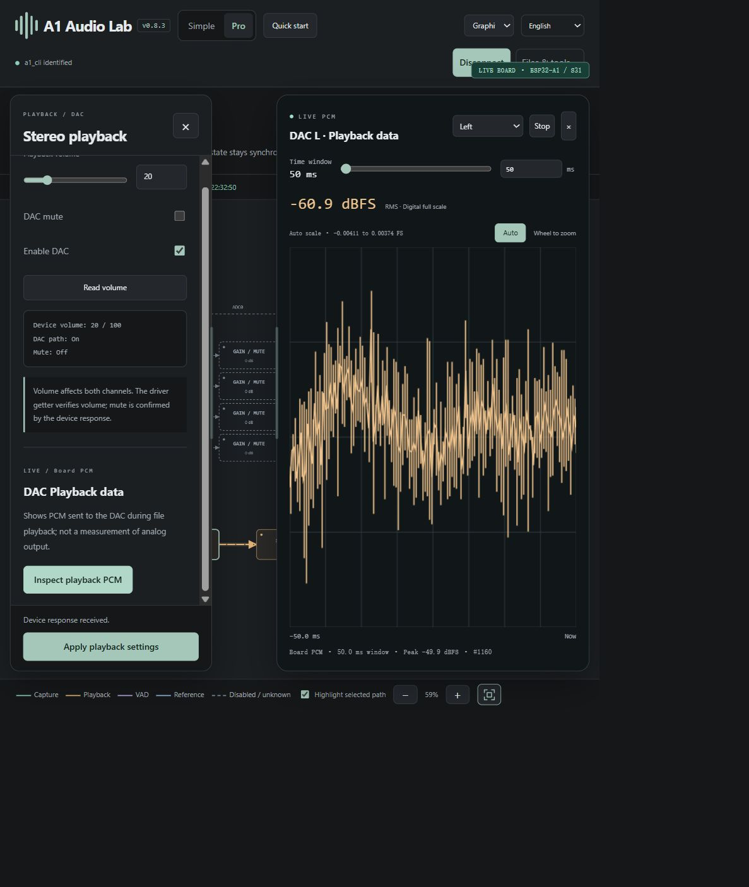

# ESP32-A1 Audio Lab

[中文](README.md) | **English**

See the ESP32-A1 audio architecture, click a block to tune it, and check device state alongside real waveforms.



I built this tool to make chip debugging easier to follow. Capture, playback, VAD and reference routing share one map, so you can adjust a block where it sits in the signal path instead of hunting through code. Settings are read back after writing, and waveform samples come directly from the board's PCM stream.

**Current versions: web v0.8.3 · debug firmware v0.4.2. Verified on an ESP32-A1 Codec + ESP32-S31 EV Board.** Every screenshot on this page shows this combination running on hardware, using the Graphite dark theme.

## Tested on hardware

| Function | Result |
| --- | --- |
| Four onboard microphones | Dynamic PCM on all four channels; per-channel gain, register readback, mute and recovery passed |
| Live waveforms | A continuous ten-second window passed, containing 480,000 sample frames at 48 kHz |
| VAD | Detection-only mode retained microphone capture; dedicated FIFO saved an 8 kHz / 16-bit / mono WAV with full-file verification |
| Duplex audio | Four microphones, stereo DAC and RE reference enabled together |
| Continuous SD recording | Browser-started 10-second, 30-second and five-minute recordings completed with exact frame counts, full-file CRC verification and zero RX overflows |
| Playback and stopping | Recorded-file playback, DAC PCM, simultaneous recording/playback, manual stop and Stop all passed |
| Registers and files | Masked writes preserved other bits and restored correctly; downloaded-file CRC matched the board |



The five-minute stereo recording at 16 kHz / 16-bit contains 4,800,000 frames in a complete 19,200,044-byte WAV. The panel shows sample progress and written size, then refreshes the list and selects the completed file.

## Get started

Download [ESP32-A1-Audio-Lab.html](https://github.com/HwzLoveDz/esp32-a1-audio-lab/raw/refs/heads/main/ESP32-A1-Audio-Lab.html). Start a local server in the same directory:

```sh
python -m http.server 8773 --bind 127.0.0.1
```

Open `http://127.0.0.1:8773/ESP32-A1-Audio-Lab.html` in desktop Chrome or Edge. Connect the board's data USB, click **Connect board** and choose its serial port. English and Mint are the first-run defaults; language and theme choices are saved. Press Ctrl+C to stop the local server when finished.

Use the debug firmware listed above; build instructions and pin configuration are in [Firmware integration](firmware/README.md). After connecting, the page reads the supported commands and device state. Choose a task from **Quick start** to configure the board.



| Example | One-click setup |
| --- | --- |
| Four microphones | 48 kHz / 24-bit, four inputs, 0 dB and live PCM |
| Voice and VAD | 16 kHz / 16-bit, one input at +6 dB, detection-only VAD and live PCM |
| Record 10 seconds | Configure two inputs, mount SD and start recording |
| File playback | Configure stereo DAC at volume 20 and read the SD file list |
| Duplex and reference | Configure four microphones, stereo DAC and the left-channel RE reference |
| Stop all audio | Stop file tasks and monitoring, then close audio paths; keep SD files |

## Tune from the map

Simple mode keeps the main paths visible. Professional mode expands all four ADC channels, gains and VAD. Click a block to open its settings on the left, then apply to write and read back. Moving a slider or entering a number does not immediately change the board. The map follows device responses, with flowing animation on enabled links.

Right-drag to pan and use the wheel to zoom around the pointer. The fit icon beside the zoom buttons centers the map in the area left clear by the panels; Home does the same. Drag panel dividers to resize them.



The waveform window spans **5 ms–10 s**, with a linear slider and numeric input. It shows RMS, peak and min/max envelopes. Vertical scaling starts in Auto; the wheel switches to manual scaling and **Auto** restores it. Panels adapt to screen height and can also be resized manually.



Use **detection-only** VAD for ordinary microphone capture. Dedicated filtered output provides the VAD FIFO; stop ordinary capture and file tasks before switching. The page handles these dependencies to keep the paths consistent.



DAC Reference selects either output channel for the TDM RE slot, making the playback reference visible in the capture path. The shared format supports the SDK's discrete 8–48 kHz rates, 16/24-bit samples and TDM channel settings.

## SD files and configurations

Mount microSD in the ESP32-S31 panel and enable ADC to record. Each recording gets a unique filename and can run for 1–1800 seconds. Manual stop drains captured data and finalizes the WAV header. Reserve space for the selected rate, depth and channel count, and finish file tasks before unmounting.

Select a mono or stereo PCM WAV from the list to prepare playback. Its rate and bit depth must match the current clock; the page checks the format. Extract the desired channels on a computer before playing a multichannel recording.



Import and export JSON configurations, then choose **Apply full configuration** to send imported settings. The register tool provides address-limited masked writes and readback. Export communication logs for troubleshooting. All page resources are included locally, with no CDN, remote fonts or analytics.

## Connection tips

- Keep the serial port open in only one application at a time.
- Start waveform monitoring after enabling a path. Check ADC mute and use detection-only VAD for ordinary capture.
- If Windows serial stops responding after flashing, keep POWER connected and reconnect only the data USB.
- Disconnecting serial leaves board tasks running; use **Stop all audio** before disconnecting when you want them stopped.

## Development and verification

Use Node.js 22 or newer:

```sh
npm ci --ignore-scripts
npm test
npm run build
```

The build produces the standalone HTML. Entry points are `index.html` and `app.mjs`; transport is in `serial.mjs`, state and parameters in `core.mjs`, and diagrams in `graph.mjs`. Run `sh tests/run-firmware-tests.sh` on Linux / WSL for the recording-buffer tests.

All **83 web/protocol tests** and **seven firmware-buffer tests** passed. Browser checks covered 153 input cases, 34 diagram entries, 12 workflows, six themes, both languages and narrow windows. Hardware results and reproduction details are collected in the [current validation record](docs/validation-v0.8.3.md). See also the [CLI / telemetry protocol](docs/protocol.md), [quality checks](docs/quality-plan.md) and [changelog](CHANGELOG.md).

## License

Project-authored web code, documentation and telemetry extensions use the [MIT License](LICENSE). Obtain external SDKs, Codec drivers and board materials under their respective licenses; see [THIRD_PARTY.md](THIRD_PARTY.md).
