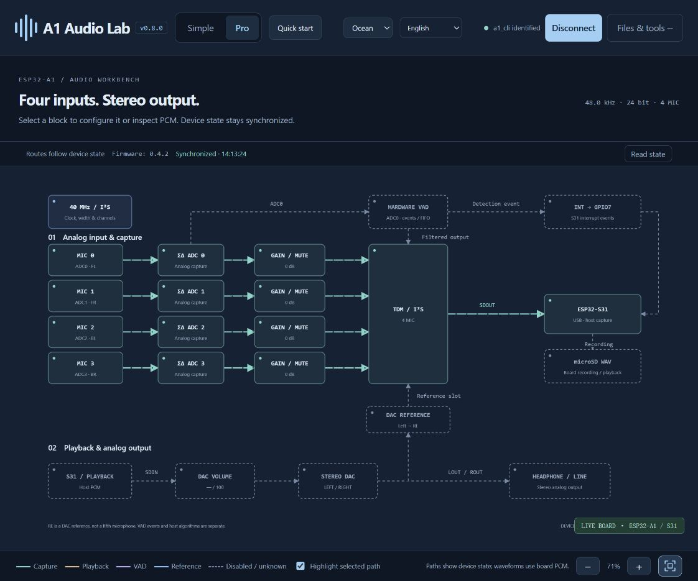
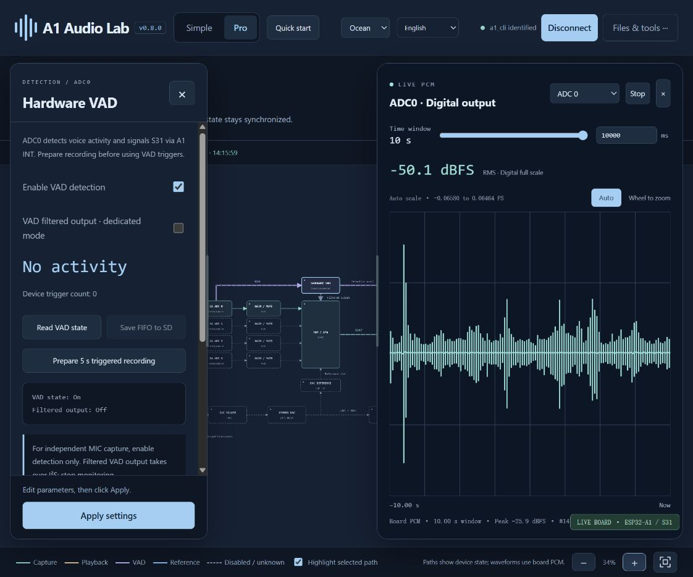

# ESP32-A1 Audio Lab

[中文](README.md) | **English**

Configure an ESP32-A1 from its signal diagram: select a block, apply settings, read back device state, and inspect real PCM data.



I built this tool to make ESP32-A1 debugging easier to follow. Instead of working through code and commands line by line, you can see the chip’s capture, playback and reference paths, select a block to tune its parameters, and inspect device state and real PCM on the same page.

Version **v0.8.0** uses English on first launch and remembers your English/Chinese preference. It targets the **ESP32-A1 Codec + ESP32-S31 EV Board**. SD recording uses **v0.4.2 buffered recording firmware**, with up to 30 minutes per file, live progress and selectable file playback. Web Serial connects the page to a compatible `a1_cli` host.

## Try the interface

Download [ESP32-A1-Audio-Lab.html](https://github.com/HwzLoveDz/esp32-a1-audio-lab/raw/refs/heads/main/ESP32-A1-Audio-Lab.html) and open it in desktop Chrome or Edge. No installation is required. Without a device, explore the simple/professional diagrams and inspect the quick-start examples.

If Web Serial is unavailable on a local file page, serve the repository locally:

```sh
python -m http.server 8773 --bind 127.0.0.1
```

Open `http://127.0.0.1:8773/ESP32-A1-Audio-Lab.html`. Stop the server with Ctrl+C when finished.

**Hardware control requires compatible firmware already running on the board.** Basic controls use the vendor CLI. State synchronization, PCM preview and long windows require `web_status`, `web_scope` and `web_scope_window` respectively. This repository includes the project-authored extension sources and [integration instructions](firmware/README.md), but no complete vendor SDK or ready-to-flash firmware. The page does not flash the board.

## Features

| Area | Controls |
| --- | --- |
| Routing | Simple/professional diagrams, left-click module selection, right-button panning, wheel zoom, fit/center beside panels and animated confirmed paths |
| MIC / ADC | 1–4 capture channels, individual digital gain, mute and gain-register readback |
| DAC | Stereo playback path, shared volume and mute |
| Shared format | SDK-supported discrete rates from 8 to 48 kHz, 16/24-bit samples and TDM channel count |
| Waveforms | Real PCM RMS, peak and min/max envelopes; linear slider and numeric input from 5 to 10000 ms |
| Layout | Automatic vertical scaling, wheel-controlled manual scaling, Auto reset and resizable panels |
| VAD / RE | ADC0 voice-activity detection and events; left/right DAC selection for the RE reference slot |
| Board files | Up to 30-minute buffered recording, live capture progress and written size, unique names, file selection, WAV format checks and VAD FIFO saving |
| Configuration | JSON import/export, restricted masked register writes and communication-log export |

Five themes are included: light, graphite, ocean, pine and ember. Preferences stay in browser storage. The page loads no CDN resources, remote fonts or analytics.

Hold the right mouse button and drag to pan. The wheel zooms at the pointer. The four-corner icon beside the zoom buttons fits and centers the diagram in the area left clear by floating panels; Home does the same. Panning is bounded, and device-state refreshes preserve manual placement.

## Start with an example

Choose **Quick start** in the top bar to configure and verify the board without opening each module. Capture examples open the live waveform automatically. Select a diagram node when you want to tune a parameter.

| Example | What it applies |
| --- | --- |
| Four microphones | 48 kHz / 24-bit, four inputs at 0 dB and the ADC0 waveform |
| Voice and VAD | 16 kHz / 16-bit, one input at +6 dB, detection-only VAD and a live waveform |
| Record 10 seconds | 16 kHz / 16-bit stereo input, SD mount and immediate recording |
| Prepare file playback | 16 kHz / 16-bit stereo DAC at volume 20 and the file list; select a matching WAV to play |
| Duplex and reference | Four MICs, stereo DAC and the left-channel RE reference |
| Stop all audio | Stop file tasks and monitoring, then close VAD, ADC, DAC and I²S; keep SD files |


Switching closes the previous paths, applies settings in dependency order and checks responses. Active file tasks block switching; Stop all waits for file tasks to stop before closing their paths. SD examples need an inserted card. Recording requires buffered firmware v0.4.2 or newer.

Editing still requires **Apply**: moving a slider or typing a value does not immediately change the device. Only the current module shows unapplied edits and an Undo action; the diagram always follows device responses. Imported JSON configurations have an **Apply full configuration** action.

## Connect a board

1. Connect the EV Board's USB data port, click the connection button and select the actual serial port.
2. The page reads the prompt and `help` at 115200 baud before enabling commands. Connecting does not start audio.
3. Configure the format in the clock block. Stop VAD, ADC, DAC and I²S before changing the shared format or RE layout.
4. Enable ADC in the MIC block, leave ADC mute off and apply settings. The page starts I²S first when needed.
5. Start waveform capture. A 0 dB digital gain is usable; adjust individual gains if more digital level is needed.

Importing a configuration loads parameters for review. Commands are sent when you click Apply full configuration. Animated paths indicate confirmed enable state; waveform data and levels establish whether capture data is changing.

### Two VAD modes

Use **detection only** for ordinary MIC capture: enable VAD and leave filtered output off. Four-channel capture remained dynamic before and after detection toggles, with RE both enabled and disabled.

Filtered VAD output takes over the I²S stream; it is not four independent MIC channels. The UI requires waveform monitoring, recording/playback and ADC/DAC to be stopped before enabling this dedicated mode, and blocks ordinary MIC monitoring while it runs. Mixing it with an RE capture layout has produced fixed-valued slots and is not supported by the UI.

### Record and play SD files

Mount microSD from the ESP32-S31 block, enable ADC, then start recording. The file list refreshes after completion and selects the new recording. Read the list manually to choose an existing file. Every recording uses a unique name.

Direct playback accepts mono or stereo PCM WAV. Set the shared sample rate and bit depth to match the file, then enable DAC; the page checks the format before playback. Extract playback channels on a computer from four-MIC-plus-RE recordings. Firmware v0.4.2 uses exact sample-count targets. Manual stop drains captured data and finalizes the WAV header. The recording card shows actual sample progress and written size. A 30-minute recording at 48 kHz / 24-bit with four MIC channels plus RE uses about 1.30 GB; reserve enough card space.


FIFO saving requires mounted SD, enabled VAD and dedicated filtered output. Detection-only mode can still prepare triggered recording but cannot read that FIFO. Stop recording and playback before unmounting SD.

## On the board

These screenshots show web v0.8.0 connected to the board running v0.4.2 debug firmware. The overview is the professional diagram with four-channel capture enabled: inputs, gain, TDM, host, playback and reference routing on one map.

### Channel gain and live PCM


Select a GAIN / MUTE block to tune that channel. Here ADC2 is set to +6 dB and checked against register 0x0069. Its panel also opens real PCM monitoring with RMS, peak and an adjustable time window.

### Detection-only VAD and long windows



Detection-only mode leaves the MIC stream available. Filtered output stays off; voice-activity status and the event counter are read separately from the PCM waveform.

### Duplex routing and DAC settings


DAC enable, volume and mute share one settings panel. VAD, TDM and DAC Reference are vertically aligned: filtered data enters TDM from above, while the playback reference returns from below. The arrows separate the two paths.

## Test results

This version passes **72 web/protocol tests** and **7 firmware recording-module tests**. The [v0.8.0 example checks](docs/validation-v0.8.0.md) cover the new workflows. The [v0.7.0 board record](docs/validation-v0.7.0.md) covers a 30-minute high-rate recording, full-file readback and CRC32, simultaneous recording/playback, stopping and restarting.

The buffered pipeline separates I²S capture from SD writes so short card stalls do not interrupt sampling. Host regression tests inject 250 ms writes, exhausted buffers, read/write failures, cancellation and resource-allocation failure. Earlier capture, gain and VAD runs are retained in [v0.5.0](docs/validation-v0.5.0.md) and [v0.6.0](docs/validation-v0.6.0.md).

## Troubleshooting

- **MIC startup returns 0x108:** configure the board's active-low Codec reset pin when creating the first Codec instance. A separately powered A1 can retain clock state across MCU resets.
- **Four-channel capture returns 0x106 after starting DAC:** TX/RX must use the same physical TDM frame width. Keep the DAC payload mask limited to its playback channels.
- **Enabled path, no input:** check ADC mute, capture enable state and dedicated VAD output mode, then start capture. Long windows need enough fresh history to fill.
- **Windows serial stops responding after flashing:** on the tested board, keeping POWER connected and reconnecting only the data USB restored communication. A serial port cannot be shared with another open client.
- **Audio continues after closing the page:** disconnecting does not stop board-side ADC/DAC or file tasks. Stop them from the relevant module first when required.

## Development

Use Node.js 22 or newer; no `npm install` is needed:

```sh
npm test
npm run build
```

The firmware recording-module tests use a C11 compiler and POSIX threads. Run `sh tests/run-firmware-tests.sh` on Linux or WSL.

The build produces the standalone `ESP32-A1-Audio-Lab.html`. UI entry points are `index.html` and `app.mjs`; `serial.mjs` handles transport, `core.mjs` handles settings/state, and `graph.mjs` renders routing. See the [protocol](docs/protocol.md), [firmware integration](firmware/README.md) and [changelog](CHANGELOG.md).

When reporting a problem, include web/firmware versions, board type, startup order and error response. Remove unique device identifiers and unrelated audio before posting.

## License

The project-authored web application, documentation and telemetry extensions use the [MIT License](LICENSE). Obtain external SDKs, Codec drivers and board documents under their respective licenses; they are not distributed here. See [THIRD_PARTY.md](THIRD_PARTY.md).
