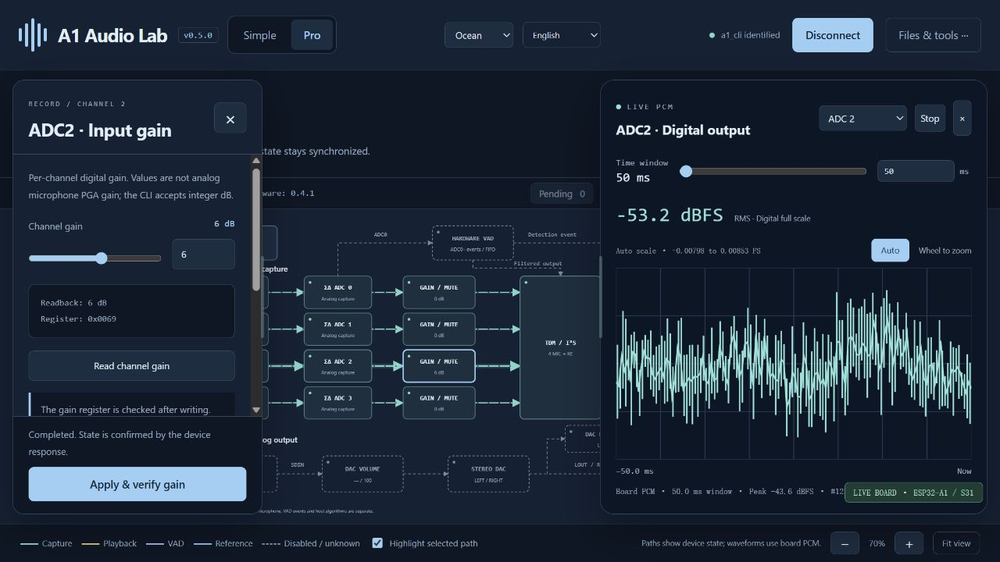
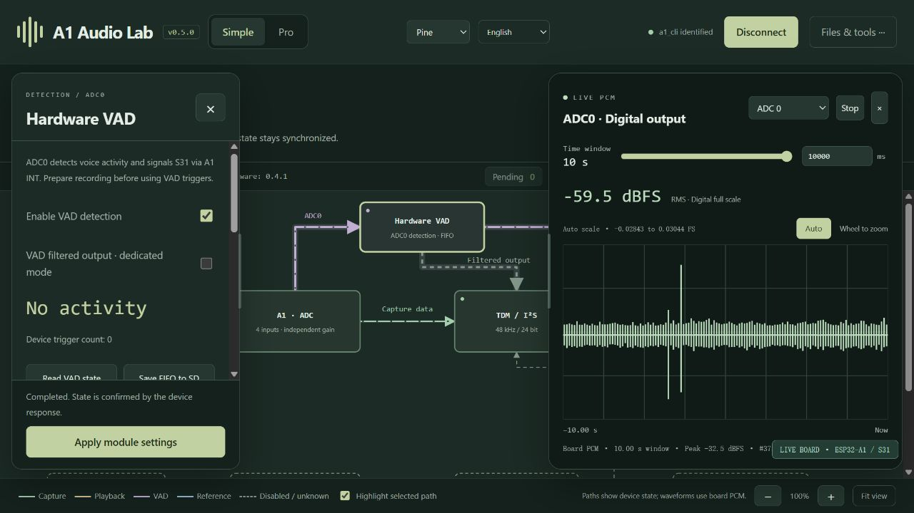
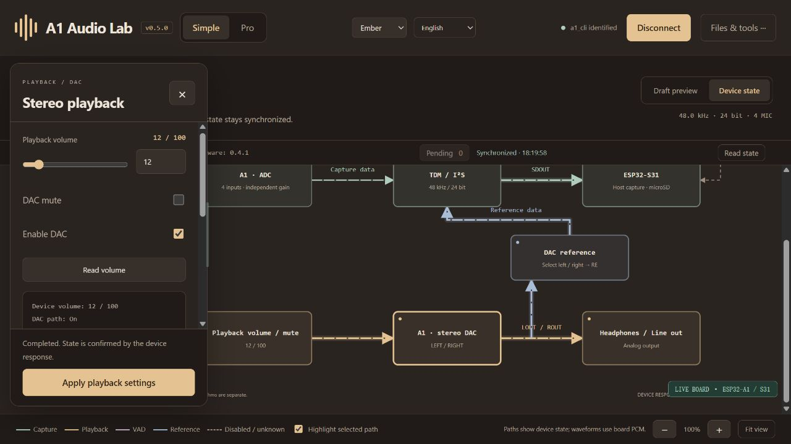

# ESP32-A1 Audio Lab

[中文](README.md) | **English**

Configure an ESP32-A1 from its signal diagram: select a block, apply settings, read back device state, and inspect real PCM data.


I built this workbench to keep audio routing, register controls and waveform inspection on one page. Draft settings stay separate from confirmed device responses.

Version **v0.5.3** uses English on first launch and remembers your English/Chinese preference. It targets the **ESP32-A1 Codec + ESP32-S31 EV Board** running debug firmware v0.4.1. The latest live-board control and PCM check used web v0.5.0; v0.5.3 updates diagram navigation. The browser uses Web Serial to communicate with compatible `a1_cli` firmware. AC101S, AC102 and the previous sound-key firmware use different protocols.

## Try the interface

Download [ESP32-A1-Audio-Lab.html](https://github.com/HwzLoveDz/esp32-a1-audio-lab/raw/refs/heads/main/ESP32-A1-Audio-Lab.html) and open it in desktop Chrome or Edge. No installation is required. Without a device, explore the simple/professional diagrams and edit configuration drafts.

If Web Serial is unavailable on a local file page, serve the repository locally:

```sh
python -m http.server 8773 --bind 127.0.0.1
```

Open `http://127.0.0.1:8773/ESP32-A1-Audio-Lab.html`. Stop the server with Ctrl+C when finished.

**Hardware control requires compatible firmware already running on the board.** Basic controls use the vendor CLI. State synchronization, PCM preview and long windows require `web_status`, `web_scope` and `web_scope_window` respectively. This repository includes the project-authored extension sources and [integration instructions](firmware/README.md), but no complete vendor SDK or ready-to-flash firmware. The page does not flash the board.

## Features

| Area | Controls |
| --- | --- |
| Routing | Simple/professional diagrams, left-click module selection, right-button panning, wheel zoom, fit/center beside panels and animated confirmed paths |
| MIC / ADC | 1–4 capture channels, individual digital gain, mute and gain-register readback |
| DAC | Stereo playback path, shared volume and mute |
| Shared format | SDK-supported discrete rates from 8 to 48 kHz, 16/24-bit samples and TDM channel count |
| Waveforms | Real PCM RMS, peak and min/max envelopes; linear slider and numeric input from 5 to 10000 ms |
| Layout | Automatic vertical scaling, wheel-controlled manual scaling, Auto reset and resizable panels |
| VAD / RE | ADC0 voice-activity detection and events; left/right DAC selection for the RE reference slot |
| Board files | microSD recording, WAV playback, VAD-triggered recording and FIFO-save controls |
| Configuration | JSON import/export, restricted masked register writes and communication-log export |

Five themes are included: light, graphite, ocean, pine and ember. Preferences stay in browser storage. The page loads no CDN resources, remote fonts or analytics.

Hold the right mouse button and drag to pan. The wheel zooms at the pointer. The four-corner icon beside the zoom buttons fits and centers the diagram in the area left clear by floating panels; Home does the same. Panning is bounded, and device-state refreshes preserve manual placement.

## Connect a board

1. Connect the EV Board's USB data port, click the connection button and select the actual serial port.
2. The page reads the prompt and `help` at 115200 baud before enabling commands. Connecting does not start audio.
3. Configure the format in the clock block. Stop VAD, ADC, DAC and I²S before changing the shared format or RE layout.
4. Enable ADC in the MIC block, leave ADC mute off and apply settings. The page starts I²S first when needed.
5. Start waveform capture. A 0 dB digital gain is usable; adjust individual gains if more digital level is needed.

Importing a configuration only changes the draft. Commands are sent when you apply settings. Animated paths indicate confirmed enable state; waveform data and levels establish whether capture data is changing.

### Two VAD modes

Use **detection only** for ordinary MIC capture: enable VAD and leave filtered output off. Four-channel capture remained dynamic before and after detection toggles, with RE both enabled and disabled.

Filtered VAD output takes over the I²S stream; it is not four independent MIC channels. The UI requires waveform monitoring, recording/playback and ADC/DAC to be stopped before enabling this dedicated mode, and blocks ordinary MIC monitoring while it runs. Mixing it with an RE capture layout has produced fixed-valued slots and is not supported by the UI.

## On the board

These four screenshots show the v0.5.0 interface connected to an ESP32-A1/S31 board running v0.4.1 debug firmware. Data comes from the board through a local serial test bridge; no synthetic waveforms are used. The overview above shows enabled capture paths and inactive playback paths.

### Channel gain and live PCM



ADC2 is set to +6 dB and checked against register 0x0069. The separate waveform panel shows the current capture data, RMS and peak; its window accepts a slider or numeric entry.

### Detection-only VAD and long windows



Detection-only mode leaves the MIC stream available. Filtered output stays off; voice-activity status and the event counter are read separately from the PCM waveform.

### Duplex routing and DAC settings



DAC enable, volume readback and mute share one apply action. RE feeds a selected DAC channel back into the capture stream. An enabled route does not by itself prove acoustic output.

## Validation

v0.5.3 passes **51 host tests**, including right-button pan, wheel zoom, movement bounds and panel-aware fit/center checks.

The v0.5.0 update passed **43 host tests** and a new live-board check on v0.4.1 debug firmware: four independent MIC streams, +6 dB gain readback, mute/unmute restoration, detection-only VAD, DAC volume/mute, and a 10-second / 480000-frame window. The screenshots above were captured from this session. See [v0.5.0 validation](docs/validation-v0.5.0.md) for scope and limits.

The broader format/reopen matrix below is the earlier v0.4.1 baseline; it was not repeated in full for v0.5.0.

| Check | v0.4.1 result |
| --- | --- |
| Host tests | 33 passing tests for transport, state, bounds, readback, waveform validation and mode separation |
| MIC and duplex paths | Dynamic PCM in six format/start-order combinations, followed by 18 MIC reopen cycles |
| 0 dB and VAD | Four dynamic channels with RE on/off, before and after detection-only toggles |
| Long windows | 5 / 50 / 500 / 1000 / 2501 / 10000 ms; 480000 sample frames for 10 seconds at 48 kHz |
| Browser UI | Diagram, themes, panel sizing, automatic/manual scaling and draft-state checks |

Hardware tests used production `core.mjs` / `serial.mjs` modules through a native serial adapter. Browser-native port permission selection, microSD file performance, DAC file-playback PCM and acoustic quality have not received the same validation coverage.

## Troubleshooting

- **MIC startup returns 0x108:** configure the board's active-low Codec reset pin when creating the first Codec instance. A separately powered A1 can retain clock state across MCU resets.
- **Four-channel capture returns 0x106 after starting DAC:** TX/RX must use the same physical TDM frame width. Keep the DAC payload mask limited to its playback channels.
- **Enabled path, no input:** check ADC mute, capture enable state and dedicated VAD output mode, then start capture. Long windows need enough fresh history to fill.
- **Windows serial stops responding after flashing:** on the tested board, keeping POWER connected and reconnecting only the data USB restored communication. A serial port cannot be shared with another open client.
- **Audio continues after closing the page:** disconnecting does not stop board-side ADC/DAC or file tasks. Stop them from the relevant module first when required.

## Development

Use Node.js 22 or newer; no `npm install` is needed:

```sh
npm test
npm run build
```

The build produces the standalone `ESP32-A1-Audio-Lab.html`. UI entry points are `index.html` and `app.mjs`; `serial.mjs` handles transport, `core.mjs` handles settings/state, and `graph.mjs` renders routing. See the [protocol](docs/protocol.md), [firmware integration](firmware/README.md) and [changelog](CHANGELOG.md).

When reporting a problem, include web/firmware versions, board type, startup order and error response. Remove unique device identifiers and unrelated audio before posting.

## License

The project-authored web application, documentation and telemetry extensions use the [MIT License](LICENSE). Obtain external SDKs, Codec drivers and board documents under their respective licenses; they are not distributed here. See [THIRD_PARTY.md](THIRD_PARTY.md).
