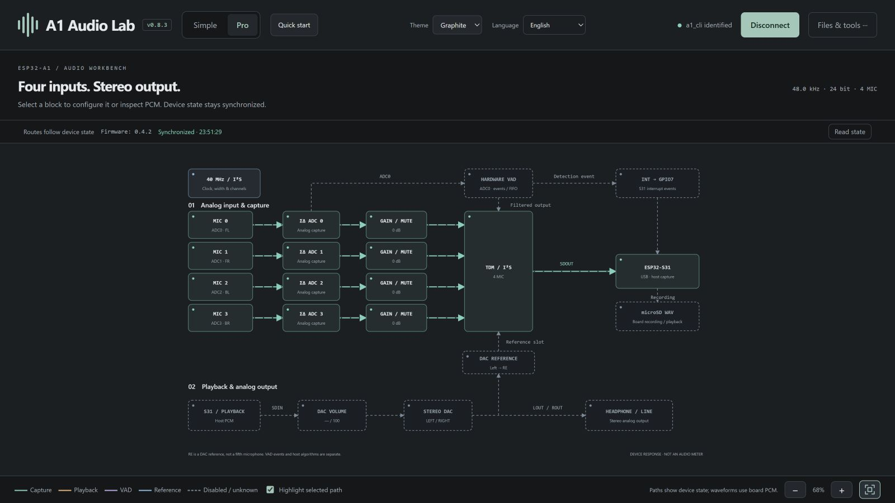
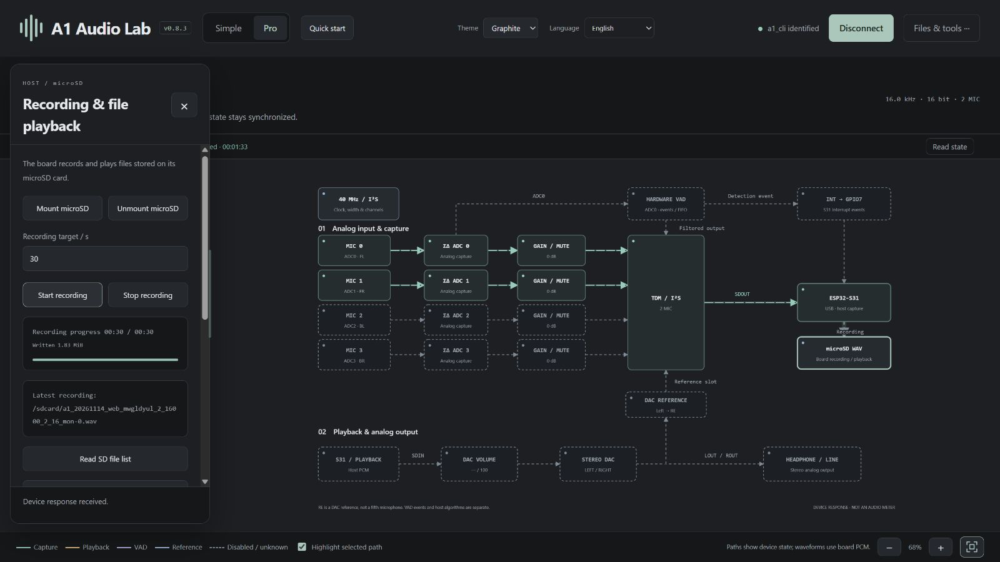
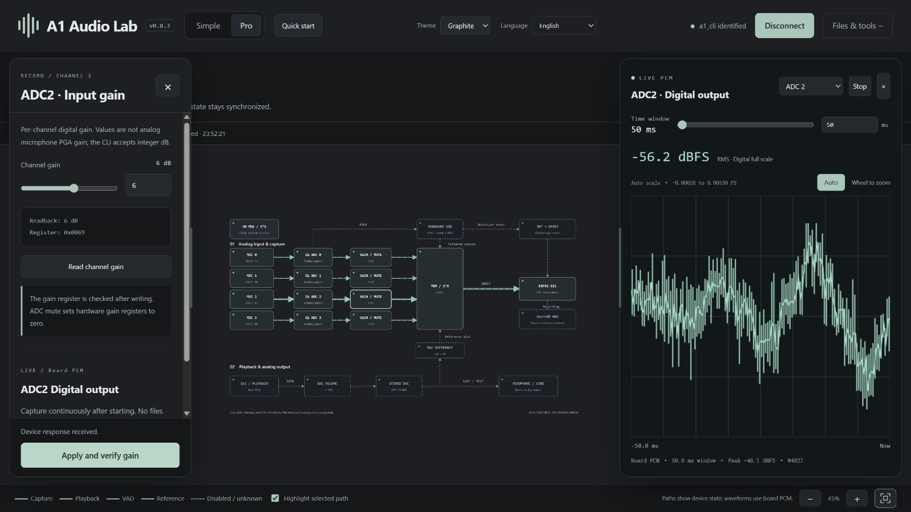
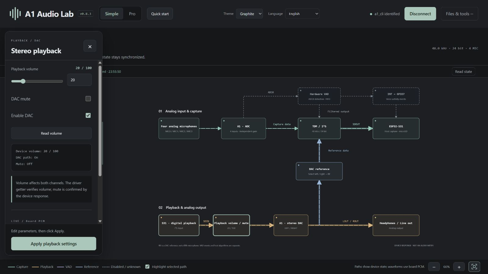

# ESP32-A1 Audio Lab

**中文** | [English](README.en.md)

看懂 ESP32-A1 的音频架构，点图调参数，直接看设备状态和真实波形。



我做这个工具，是想让芯片调试直观一些：不用对着代码一行行找设置，在一张框图上看清采集、播放、VAD 和回采的关系，点到哪里就调哪里。参数写入后读回确认，波形直接取自板端 PCM，顺着信号路径就能逐段检查。

**当前版本：网页 v0.8.3 · 调试固件 v0.4.2。已在 ESP32-A1 Codec + ESP32-S31 EV Board 上通过实板验证。**

## 已经跑通

| 功能 | 实板验证结果 |
| --- | --- |
| 四路板载 MIC | 四路均取得动态 PCM；逐通道增益写入、寄存器读回、静音与恢复通过 |
| 实时波形 | 10 秒连续采样窗口通过，48 kHz 下包含 480,000 个采样帧 |
| VAD | 仅检测模式下 MIC 继续采样；专用 FIFO 保存为 8 kHz / 16-bit / 单声道 WAV，完整文件校验通过 |
| 双向音频 | 四路 MIC、双声道 DAC 与 RE 回采同时开启通过 |
| SD 连续录音 | 网页启动的 10 秒、30 秒、5 分钟录音全部完成；采样数精确、完整文件 CRC 校验通过、接收溢出为 0 |
| 文件播放与停止 | 录音文件点选播放、DAC PCM、同时录放、手动停止与停止全部音频通过 |
| 寄存器与文件 | 掩码写入保留其他位，恢复读回通过；文件下载与板端 CRC 一致 |



五分钟录音采用 16 kHz / 16-bit / 双声道，得到 4,800,000 帧、19,200,044 字节的完整 WAV。界面显示采样进度和写入大小，完成后自动刷新并选中文件。

## 开始使用

下载 [独立网页 ESP32-A1-Audio-Lab.html](https://github.com/HwzLoveDz/esp32-a1-audio-lab/raw/refs/heads/main/ESP32-A1-Audio-Lab.html)。在文件所在目录启动本地服务：

```sh
python -m http.server 8773 --bind 127.0.0.1
```

用桌面 Chrome 或 Edge 访问 `http://127.0.0.1:8773/ESP32-A1-Audio-Lab.html`，连接开发板的数据 USB，点击 **Connect board** 并选择串口。首次打开默认英语、Mint 主题，可随时切换中文和主题，浏览器会记住选择。结束本地服务时按 Ctrl+C。

板端使用上面标明的调试固件，构建与引脚配置见[固件集成](firmware/README.md)。连接后网页自动读取命令和设备状态，随后从顶栏 **Quick start / 常用示例** 选择任务即可。


| 示例 | 一键完成 |
| --- | --- |
| 四路麦克风 | 48 kHz / 24-bit、四路输入、0 dB，并打开实时波形 |
| 语音与 VAD | 16 kHz / 16-bit、单路 +6 dB、VAD 仅检测和实时波形 |
| 录制 10 秒 | 配置双路输入、挂载 SD 并开始录音 |
| 文件播放准备 | 配置双声道 DAC、音量 20，读取 SD 文件列表 |
| 双向采集与回采 | 同时配置四路 MIC、双声道 DAC 和左声道 RE 参考 |
| 停止全部音频 | 停止录放和波形，再关闭音频通路；保留 SD 文件 |

## 点图调试

简易图保留主要信号路径，专业图展开四路 ADC、增益与 VAD。点击模块在左侧设置，点击“应用”后写入并读回；输入数字或拖动滑条时不会立即改设备。框图跟随设备应答，开启的链路显示流动动画。

按住右键拖动框图，滚轮以鼠标位置为中心缩放。加减按钮旁的自适应图标会避开悬窗、居中显示整图，也可按 Home。面板宽度可拖动调整。



波形窗口支持 **5 ms–10 s** 线性滑条和数字输入，显示 RMS、峰值与 min/max 包络。纵轴默认自适应，滚轮切换为手动缩放，点击“自动”恢复；窗口按屏幕高度布局，也可手动调整。


普通 MIC 采集选择 VAD **仅检测**。专用滤波输出用于读取 VAD FIFO，切换前先停止普通采集和录放；页面会处理这些依赖，避免通路冲突。



DAC Reference 从左右声道选择一路送回 TDM 的 RE 槽，便于观察播放参考。共享时钟支持 SDK 提供的 8–48 kHz 离散采样率、16/24 bit 和 TDM 通道配置。

## SD 录放与配置

在 ESP32-S31 模块中挂载 microSD，再开启 ADC 录音。单次录音可设为 1–1800 秒，每次生成独立文件名；手动停止会写完已采集数据并更新 WAV 头。按采样率、位深和通道数预留卡空间，录放结束后再卸载卡。

点击文件列表中的单声道或双声道 PCM WAV 即可准备播放。采样率与位深需和当前时钟一致，页面会检查格式。多通道录音可先在电脑上提取所需声道。


JSON 配置可以导入、导出，导入后点击“应用整套配置”再写入。寄存器工具提供限定地址的掩码写入和读回，通信记录可导出用于排查问题。页面资源全部随文件提供，无需 CDN、远程字体或分析服务。

## 连接排查

- 同一串口一次只由一个程序使用，先关闭其他串口工具。
- 路径开启后，点击开始波形采集观察输入；确认 ADC 未静音，普通采集使用 VAD 仅检测。
- 刷写后 Windows 串口没有应答时，保持 POWER 供电，重新插拔数据 USB。
- 断开串口不会停止板端任务；需要停止时，先点“停止全部音频”。

## 开发与验证

使用 Node.js 22 或更新版本：

```sh
npm ci --ignore-scripts
npm test
npm run build
```

构建生成独立网页。入口是 `index.html` 和 `app.mjs`，通信在 `serial.mjs`，参数与状态在 `core.mjs`，框图在 `graph.mjs`。固件缓冲模块测试可在 Linux / WSL 运行 `sh tests/run-firmware-tests.sh`。

当前网页与协议 **83 项测试通过**，固件缓冲模块 **7 项测试通过**。浏览器检查覆盖 153 个输入用例、34 个框图入口、12 条流程、六套主题、中英文及窄窗口。实板结果与复现信息集中在[当前验证记录](docs/validation-v0.8.3.md)。另见 [CLI / 遥测协议](docs/protocol.md)、[质量检查方法](docs/quality-plan.md)和[更新记录](CHANGELOG.md)。

## 许可

自行编写的网页、文档和遥测扩展采用 [MIT License](LICENSE)。外部 SDK、Codec 驱动及开发板资料按各自许可获取，见 [THIRD_PARTY.md](THIRD_PARTY.md)。
