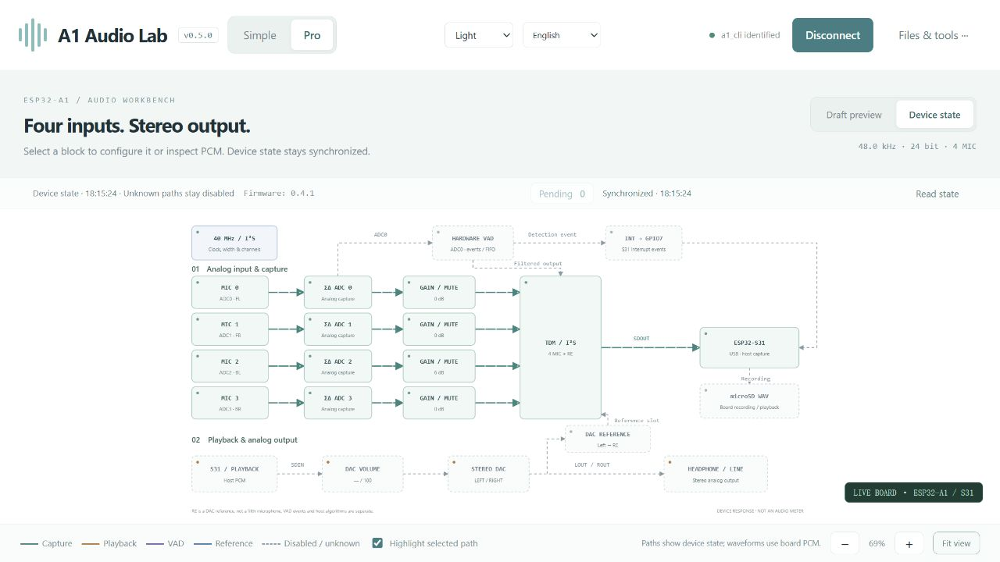
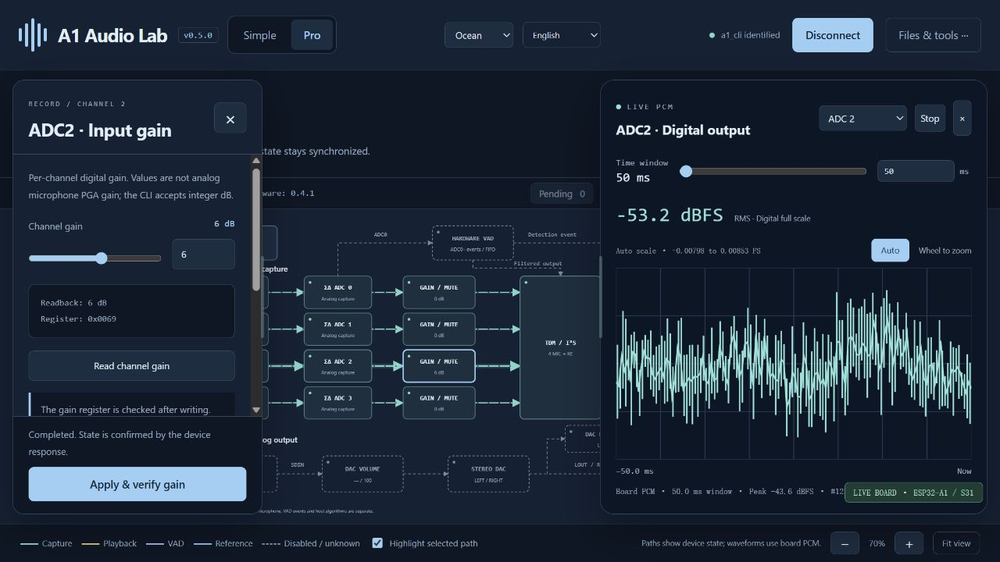
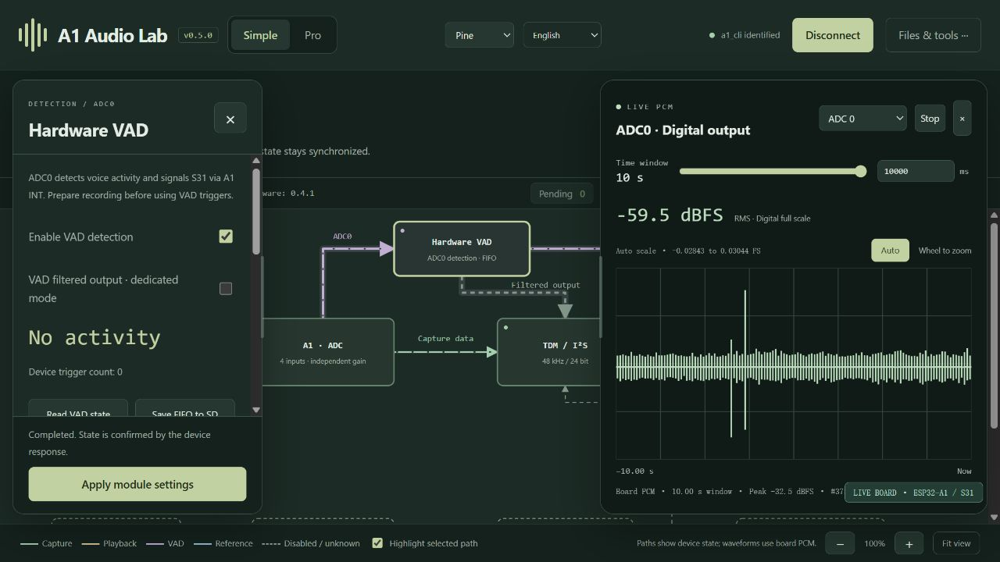
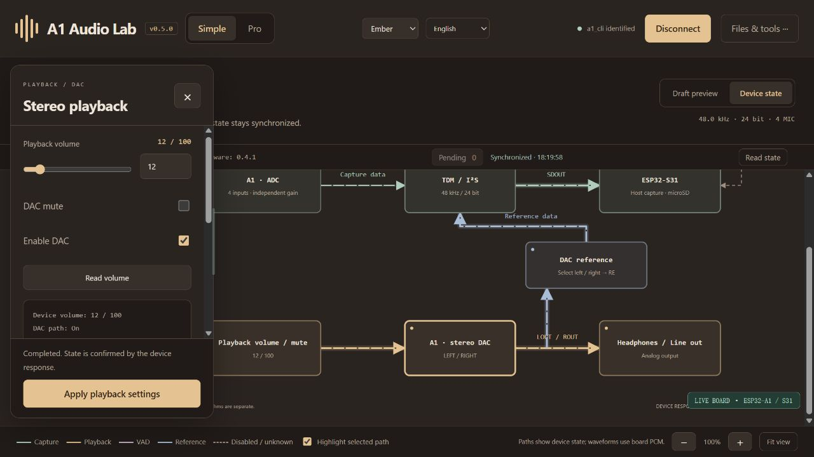

# ESP32-A1 Audio Lab

**中文** | [English](README.en.md)

在一张音频链路图上配置 ESP32-A1：点模块调参数，读回设备状态，再看实际 PCM 波形。



我做这个工具，是想把音频路径、寄存器和波形放在同一个工作台里。调麦克风时不用来回切页面，也能分清参数还在草稿里，还是已经写进了设备。

当前网页版本 **v0.5.3**，首次打开默认英语，可切换中文并记住选择；面向 **ESP32-A1 Codec + ESP32-S31 EV Board** 和 v0.4.1 调试固件。通路与采样实板记录来自 v0.5.0，v0.5.3 更新框图导航。它通过浏览器 Web Serial 连接运行兼容 `a1_cli` 的主控。AC101S、AC102 和旧声音钥匙固件使用其他协议，不能混用。

## 先打开看看

下载 [ESP32-A1-Audio-Lab.html](https://github.com/HwzLoveDz/esp32-a1-audio-lab/raw/refs/heads/main/ESP32-A1-Audio-Lab.html)，用桌面 Chrome 或 Edge 打开。无需安装依赖，未连接设备时可以浏览简易／专业框图和编辑配置草稿。

若本地文件页面没有 Web Serial，可在仓库目录运行：

```sh
python -m http.server 8773 --bind 127.0.0.1
```

访问 `http://127.0.0.1:8773/ESP32-A1-Audio-Lab.html`；结束后按 Ctrl+C 停止服务。

**实际调试需要板上已有兼容固件。** 普通参数控制依赖原厂 CLI；状态同步、真实波形和长时间窗分别需要 `web_status`、`web_scope`、`web_scope_window` 扩展。仓库包含自行编写的扩展源码与[集成说明](firmware/README.md)，不包含完整厂商 SDK 或可直接烧录的固件。网页不会自动刷写开发板。

## 能做什么

| 模块 | 操作 |
| --- | --- |
| 音频路径 | 简易／专业切换、左键点选节点、右键抓握平移、滚轮缩放、避开悬窗自适应居中；已确认开启的路径显示流动动画 |
| MIC / ADC | 1–4 路采集、逐通道数字增益、静音和增益寄存器读回 |
| DAC | 双声道播放通路、共同音量和静音 |
| 共享格式 | SDK 支持的 8–48 kHz 离散采样率、16/24 bit、TDM 通道数 |
| 实时波形 | 实际 PCM 的 RMS、峰值、min/max 包络；5–10000 ms 线性滑条和数字输入 |
| 显示 | 纵轴默认自适应；滚轮进入手动缩放；点击“自动”恢复；悬窗宽度可拖动 |
| VAD / RE | ADC0 语音活动检测和事件；DAC 左右择一路作为 RE 回采 |
| 板端文件 | microSD 录音、WAV 播放、VAD 触发录音与 FIFO 保存入口 |
| 配置与排错 | JSON 导入导出、限定地址的掩码写入、通信记录导出 |

界面提供浅色、石墨、深海、松墨和暖夜主题。偏好保存在浏览器中；页面不加载 CDN、远程字体或分析服务。

框图上按住右键拖动来移动视图，滚轮以鼠标位置为中心缩放。加减旁的四角图标可按悬窗之外的可见区域自适应并居中；也可按 Home。平移有四边限位，状态刷新会保留手动位置。

## 接上设备

1. 连接 EV Board 的 USB 数据口，点击“连接开发板”，选择实际串口。
2. 网页以 115200 baud 读取提示符和 `help`，确认 CLI 命令后开放控制。连接本身不启动音频。
3. 在时钟模块设置格式。更改格式或 RE 布局前，先关闭 VAD、ADC、DAC 和 I²S。
4. 在 MIC 模块开启 ADC，保持“ADC 静音”关闭，点击写入。网页会先启动所需的 I²S。
5. 点击“开始采集波形”。默认 0 dB 可用；需要提高数字电平时，再逐通道调整增益。

配置导入只改草稿，写入按钮才下发命令。“设备应答”来自设备返回；路径动画表示通路已开启，实际输入要看波形和电平。

### VAD 的两个模式

普通 MIC 采集使用 **仅检测**：启用 VAD，保持“VAD 滤波输出”关闭。实测在 RE 开关两种布局下，检测启停前后四路 MIC 均能继续采样。

“VAD 滤波输出”是专用模式，会接管 I²S 数据，不能同时当作四路独立 MIC。网页要求先停止波形、录放和 ADC / DAC，再启用它；专用输出运行时不开放普通 MIC 波形。RE 布局下混用后出现过固定值槽位，当前不支持这种混用方式。

## 实板运行

这四张图来自 v0.5.0 网页连接 ESP32-A1/S31 实板、运行 v0.4.1 调试固件的状态。数据通过本地串口测试桥读取，没有使用合成波形。首图展示四路采集已开启、播放通路未开启的总览。

### 逐通道增益与实时 PCM



ADC2 设置为 +6 dB，并读取 0x0069 寄存器核对。右侧独立波形窗口显示当前采样、RMS 与峰值，时间窗可用滑条或数字输入调整。

### VAD 仅检测与长时间窗



仅检测模式保留 MIC 采样流；滤波输出保持关闭。语音活动状态和事件计数独立读回，不用波形有无变化代替 VAD 结果。

### 双向通路与 DAC 设置



DAC 开关、音量读回和静音使用同一个写入按钮。RE 将选定的 DAC 声道送回采集流；通路开启本身不代表已经测到模拟声音输出。

## 验证到哪一步

v0.5.3 通过 **51 项主机测试**，新增右键平移、滚轮缩放、限位及避开悬窗居中的检查。

v0.5.0 通过 **43 项主机测试**，并使用 v0.4.1 调试固件重新检查了四路独立 MIC、+6 dB 增益读回、静音往返、VAD 仅检测、DAC 音量与静音，以及十秒／480000 帧采样窗。上方四张图来自本轮实板连接，范围与边界见 [v0.5.0 验收记录](docs/validation-v0.5.0.md)。

下表保留 v0.4.1 的格式组合与重开测试记录，本轮未完整重跑该矩阵。

| 检查 | v0.4.1 结果 |
| --- | --- |
| 主机测试 | 33 项通过，覆盖通信、状态、参数边界、写后核对、波形校验和模式区分 |
| MIC 与收发通路 | 6 组格式和启用顺序组合获得动态 PCM，另完成 18 次 MIC 通道重开 |
| 0 dB 与 VAD | RE 开关两种布局、VAD 仅检测开关前后，四路均有动态 PCM |
| 长时间窗 | 5 / 50 / 500 / 1000 / 2501 / 10000 ms；48 kHz 下 10 秒对应 480000 个采样帧 |
| 浏览器界面 | 框图、主题、悬窗、自动／手动缩放和配置草稿检查通过 |

设备测试通过生产 `core.mjs` / `serial.mjs` 和原生串口适配器执行。浏览器原生串口权限选择、microSD 文件录放性能、DAC 文件播放 PCM 和音质指标尚未完成相同范围的验收。

## 常见问题

- **MIC 开启返回 0x108**：检查首次创建 Codec 时是否配置板上的低有效复位脚。A1 独立供电时可能保留 MCU 重启前的时钟状态。
- **先开播放再开四路 MIC 返回 0x106**：TX/RX 应使用相同物理 TDM 帧宽，DAC 数据掩码仍只覆盖播放声道。
- **路径亮了但没有输入**：检查 ADC 静音、采集通路和 VAD 专用输出模式，再开始波形采集。长时间窗需要先积累足够的新数据。
- **刷写后 Windows 串口不应答**：测试板可保持 POWER 供电，只重插数据 USB 恢复。网页和其他串口程序不能同时占用同一端口。
- **关闭网页后板子还在工作**：断开串口不会自动关闭已开启的 ADC/DAC 或录放任务；需要停止时先在模块中操作。

## 开发

使用 Node.js 22 或更新版本，无需 `npm install`：

```sh
npm test
npm run build
```

构建生成独立单文件 `ESP32-A1-Audio-Lab.html`。入口是 `index.html` 和 `app.mjs`；通信在 `serial.mjs`，参数与状态在 `core.mjs`，框图在 `graph.mjs`。另见 [CLI / 遥测协议](docs/protocol.md)、[固件集成](firmware/README.md)和[版本记录](CHANGELOG.md)。

反馈问题时请附网页／固件版本、板型、开启顺序和错误应答。提交前删掉设备唯一标识及与问题无关的录音。

## 许可

本仓库自行编写的网页、文档和遥测扩展采用 [MIT License](LICENSE)。外部 SDK、Codec 驱动和开发板资料按各自许可获取和使用，未随本仓库分发。详见 [THIRD_PARTY.md](THIRD_PARTY.md)。
