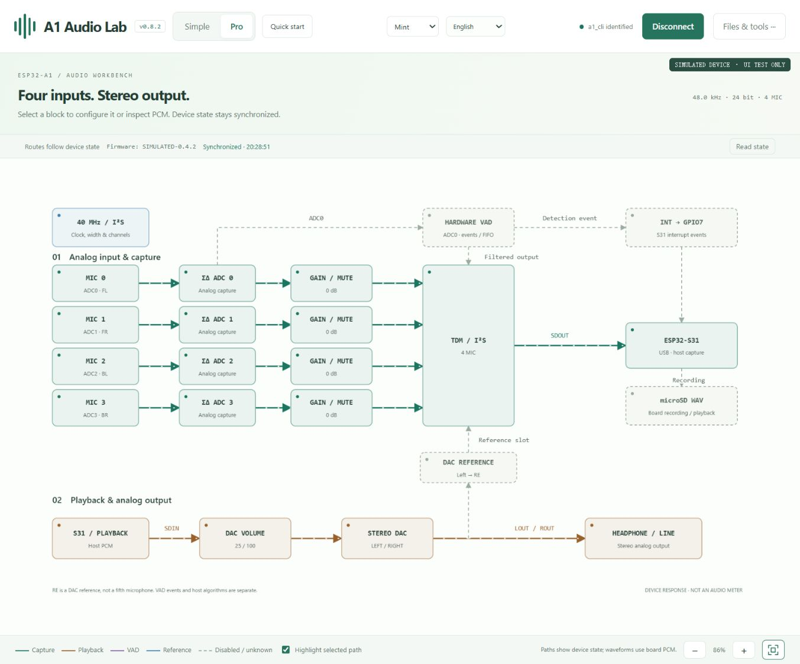
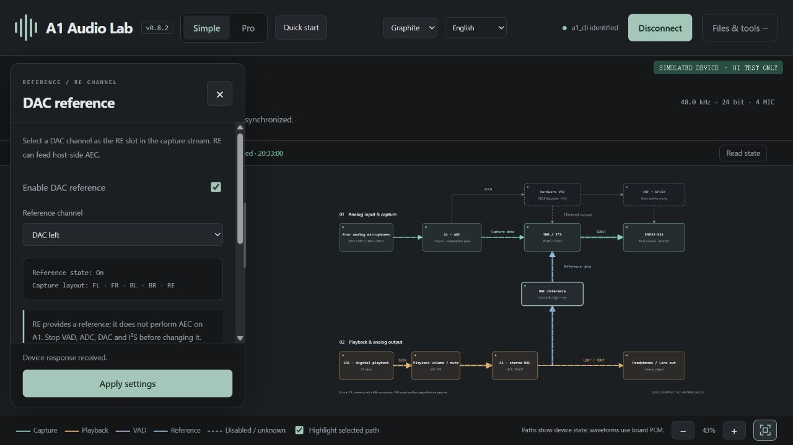
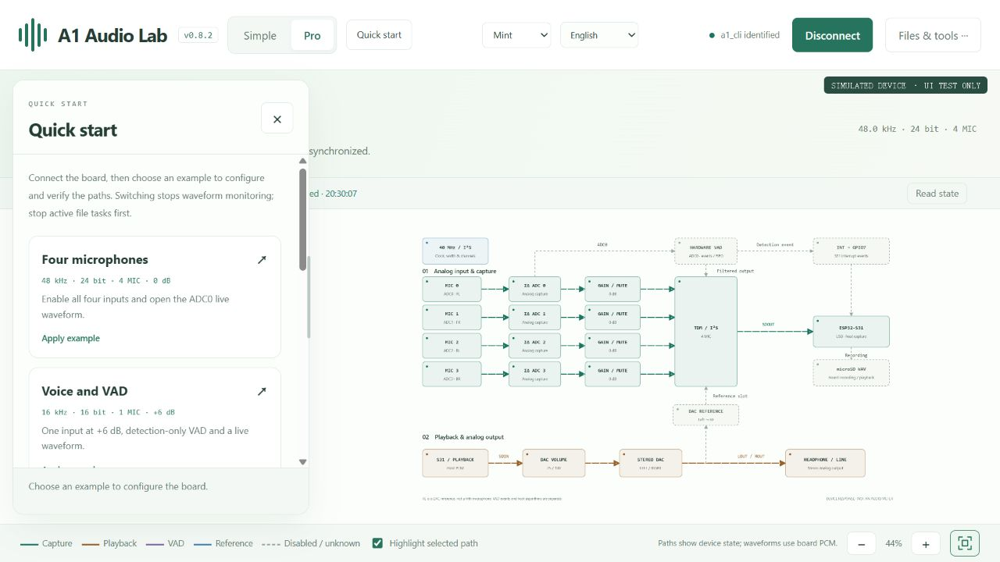
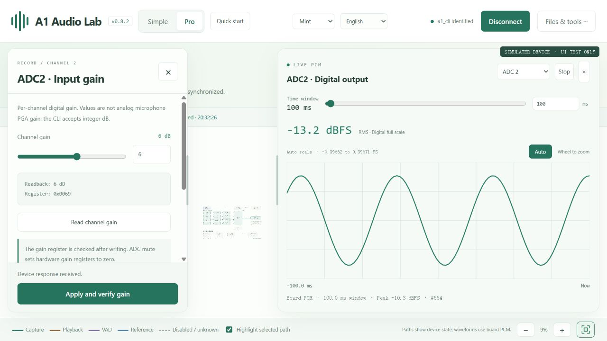

# ESP32-A1 Audio Lab

**中文** | [English](README.en.md)

看懂 ESP32-A1 的音频架构，点图调参数，直接看设备状态和实际波形。



v0.8.2 界面预览，图中的状态和波形由假设备提供；[实板运行图](docs/board-gallery-v0.8.0.md)保留了实际采集、录放和寄存器读回记录。

我做这个工具，是想让 ESP32-A1 的调试直观一些。在框图里看清采集、播放和回采通路，点选模块调参数，再看读回状态和波形，就能顺着信号经过的位置逐段检查。

当前网页版本 **v0.8.3**，首次打开使用英语和 Mint（薄荷）主题，之后保留手动选择的语言和主题；面向 **ESP32-A1 Codec + ESP32-S31 EV Board**。SD 录音使用 **v0.4.2 缓冲录音固件**，支持单次 30 分钟录音、实时进度和文件点选播放。浏览器通过 Web Serial 连接兼容的 `a1_cli` 主控。

## 先打开看看

下载 [ESP32-A1-Audio-Lab.html](https://github.com/HwzLoveDz/esp32-a1-audio-lab/raw/refs/heads/main/ESP32-A1-Audio-Lab.html)，用桌面 Chrome 或 Edge 打开。无需安装依赖，未连接设备时可以浏览简易／专业框图和查看示例。

若本地文件页面没有 Web Serial，可在仓库目录运行：

```sh
python -m http.server 8773 --bind 127.0.0.1
```

访问 `http://127.0.0.1:8773/ESP32-A1-Audio-Lab.html`；结束后按 Ctrl+C 停止服务。

**实际调试需要板上已有兼容固件。** 普通参数控制依赖原厂 CLI；状态同步、真实波形和长时间窗分别需要 `web_status`、`web_scope`、`web_scope_window` 扩展。仓库包含自行编写的扩展源码与[集成说明](firmware/README.md)，不包含完整厂商 SDK 或可直接烧录的固件。网页不会自动刷写开发板。

## 能做什么

| 模块 | 操作 |
| --- | --- |
| 音频路径 | 简易／专业切换、左键点选节点、右键抓握平移、滚轮缩放、避开悬窗自适应居中；已确认开启的路径显示流动动画 |
| MIC / ADC | 1–4 路采集、逐通道数字增益、静音和增益寄存器读回 |
| DAC | 双声道播放通路、共同音量和静音 |
| 共享格式 | SDK 支持的 8–48 kHz 离散采样率、16/24 bit、TDM 通道数 |
| 实时波形 | 实际 PCM 的 RMS、峰值、min/max 包络；5–10000 ms 线性滑条和数字输入 |
| 显示 | 纵轴默认自适应；滚轮进入手动缩放；点击“自动”恢复；悬窗宽度可拖动 |
| VAD / RE | ADC0 语音活动检测和事件；DAC 左右择一路作为 RE 回采 |
| 板端文件 | 最长 30 分钟缓冲录音、实时采样进度与写入大小、独立文件名、文件列表点选、WAV 格式核对和 VAD FIFO 保存 |
| 配置与排错 | JSON 导入导出、限定地址的掩码写入、通信记录导出 |

界面提供浅色、薄荷、石墨、深海、松墨和暖夜主题。偏好保存在浏览器中；页面不加载 CDN、远程字体或分析服务。

框图上按住右键拖动来移动视图，滚轮以鼠标位置为中心缩放。加减旁的四角图标可按悬窗之外的可见区域自适应并居中；也可按 Home。平移有四边限位，状态刷新会保留手动位置。



简易图保留主要信号路径，专业图展开四路 ADC、增益与 VAD。DAC Reference 从播放端取一路参考信号，单独接回 TDM；它不执行 AEC 算法。

## 从示例开始

顶栏的“常用示例”可以直接配置并核对设备，无需逐个打开模块。采集示例应用后会自动显示实时波形；需要改参数时再点对应节点。

| 示例 | 一键完成 |
| --- | --- |
| 四路麦克风 | 48 kHz / 24-bit、四路输入、0 dB，并查看 ADC0 波形 |
| 语音与 VAD | 16 kHz / 16-bit、单路 +6 dB、VAD 仅检测和实时波形 |
| 录制 10 秒 | 16 kHz / 16-bit 双路输入、挂载 SD 并开始录音 |
| 文件播放准备 | 16 kHz / 16-bit 双声道 DAC、音量 20、读取文件列表；选取匹配的 WAV 后播放 |
| 双向采集与回采 | 四路 MIC、双声道 DAC 和左声道 RE 参考 |
| 停止全部音频 | 停止录放与监测，再关闭 VAD、ADC、DAC 和 I²S；保留 SD 文件 |



切换示例时会先停止旧通路，再按依赖顺序配置并读回。录放任务进行中会阻止切换；“停止全部音频”会等待文件任务完成停止后再关闭通路。需要 SD 的示例要求已插卡，录音还需 v0.4.2 或更新的缓冲录音固件。

参数编辑保留“应用”这一步：拖动滑条或输入数字不会立即改设备。界面只在当前模块提示未应用的修改，并提供撤销；框图始终显示设备应答。导入 JSON 后可点击“应用整套配置”一次完成设置。



点选 ADC2 后，在左侧调整数字增益并读回寄存器；右侧可查看同一路 PCM。输入为空或超出整数范围时会阻止应用。时间窗可在 5 ms 到 10 s 之间调节，纵轴滚轮缩放后可点“自动”恢复。

## 接上设备

1. 连接 EV Board 的 USB 数据口，点击“连接开发板”，选择实际串口。
2. 网页以 115200 baud 读取提示符和 `help`，确认 CLI 命令后开放控制。连接本身不启动音频。
3. 在时钟模块设置格式。更改格式或 RE 布局前，先关闭 VAD、ADC、DAC 和 I²S。
4. 在 MIC 模块开启 ADC，保持“ADC 静音”关闭，点击写入。网页会先启动所需的 I²S。
5. 点击“开始采集波形”。默认 0 dB 可用；需要提高数字电平时，再逐通道调整增益。

配置导入只载入参数，点击应用后才下发命令。“设备应答”来自设备返回；路径动画表示通路已开启，实际输入要看波形和电平。

### VAD 的两个模式

普通 MIC 采集使用 **仅检测**：启用 VAD，保持“VAD 滤波输出”关闭。实测在 RE 开关两种布局下，检测启停前后四路 MIC 均能继续采样。

“VAD 滤波输出”是专用模式，会接管 I²S 数据，不能同时当作四路独立 MIC。网页要求先停止波形、录放和 ADC / DAC，再启用它；专用输出运行时不开放普通 MIC 波形。RE 布局下混用后出现过固定值槽位，当前不支持这种混用方式。

### SD 录音与播放

在 ESP32-S31 模块挂载 microSD，开启 ADC 后开始录音。完成后文件列表自动刷新，并选中本次文件；也可以手动读取列表、点击已有文件。每次录音使用独立名称。

直接播放使用单声道或双声道 PCM WAV。先在时钟模块设置与文件相同的采样率、位深，再开启 DAC；页面会在播放前检查格式。四路 MIC 加 RE 的五通道录音需要先在电脑上提取播放声道。v0.4.2 按采样帧数计时；手动停止会写完已捕获的数据并更新 WAV 头。录音卡片显示实际采样进度和已写入大小。48 kHz / 24-bit / 四路 MIC 加 RE 的 30 分钟录音约占 1.30 GB，请预留相应空间。

VAD 的“保存 FIFO 到 SD”在 SD 已挂载、VAD 已启用且专用滤波输出已开启时可用。仅检测模式仍可准备触发录音，但不能读取这个 FIFO。录放期间先停止任务，再卸载 SD。

## 实板运行记录

[实板图集](docs/board-gallery-v0.8.0.md)使用 v0.8.0 网页和 v0.4.2 调试固件拍摄，包含四路采集、ADC2 +6 dB 读回、十秒 PCM 窗口、DAC 回采、SD 录音进度和常用示例。新版界面图与这些实板结果分别标明版本。

## 实测记录

本版通过 **83 项网页与协议测试**，包含[首次启动与主题偏好检查](docs/validation-v0.8.3.md)。v0.8.2 的浏览器检查覆盖 33 个控件的 153 个输入用例、34 个框图入口、12 条操作流程及六套主题；另有 7,700 轮属性／模型测试和 300 步固定种子交互检查。详见 [v0.8.2 界面验收](docs/validation-v0.8.2.md)。

固件缓冲模块的 7 项测试及实板结果保留在对应版本记录中，示例实板记录见 [v0.8.0](docs/validation-v0.8.0.md)。连续录放记录见 [v0.7.0](docs/validation-v0.7.0.md)，包含 30 分钟高码率连续录音、文件全读与 CRC32、同时录放、停止和重开。

缓冲队列把 I²S 采集与 SD 写入分开，写卡短暂停顿时仍能继续接收采样。主机回归测试覆盖 250 ms 慢写、缓冲耗尽、读写失败、取消和资源回收。早期的采集、增益及 VAD 记录保留在 [v0.5.0](docs/validation-v0.5.0.md) 和 [v0.6.0](docs/validation-v0.6.0.md)。

## 常见问题

- **MIC 开启返回 0x108**：检查首次创建 Codec 时是否配置板上的低有效复位脚。A1 独立供电时可能保留 MCU 重启前的时钟状态。
- **先开播放再开四路 MIC 返回 0x106**：TX/RX 应使用相同物理 TDM 帧宽，DAC 数据掩码仍只覆盖播放声道。
- **路径亮了但没有输入**：检查 ADC 静音、采集通路和 VAD 专用输出模式，再开始波形采集。长时间窗需要先积累足够的新数据。
- **刷写后 Windows 串口不应答**：测试板可保持 POWER 供电，只重插数据 USB 恢复。网页和其他串口程序不能同时占用同一端口。
- **关闭网页后板子还在工作**：断开串口不会自动关闭已开启的 ADC/DAC 或录放任务；需要停止时先在模块中操作。

## 开发

使用 Node.js 22 或更新版本，先安装锁定的测试依赖：

```sh
npm ci --ignore-scripts
npm test
npm run build
```

固件缓冲模块的主机测试使用 C11 编译器和 POSIX 线程，可在 Linux / WSL 运行 `sh tests/run-firmware-tests.sh`。

构建生成独立单文件 `ESP32-A1-Audio-Lab.html`。入口是 `index.html` 和 `app.mjs`；通信在 `serial.mjs`，参数与状态在 `core.mjs`，框图在 `graph.mjs`。另见 [CLI / 遥测协议](docs/protocol.md)、[固件集成](firmware/README.md)和[版本记录](CHANGELOG.md)。

反馈问题时请附网页／固件版本、板型、开启顺序和错误应答。提交前删掉设备唯一标识及与问题无关的录音。

开发浏览器功能时，可运行 `npm run test:browser`，打开服务输出的 HTTP 测试地址。假设备在应用启动前接管传输，测试页面不能访问实际串口、USB 或麦克风；`/preview.html` 提供没有验收工具栏的交互预览。完整检查与复现步骤见[质量计划](docs/quality-plan.md)。

## 许可

本仓库自行编写的网页、文档和遥测扩展采用 [MIT License](LICENSE)。外部 SDK、Codec 驱动和开发板资料按各自许可获取和使用，未随本仓库分发。详见 [THIRD_PARTY.md](THIRD_PARTY.md)。
