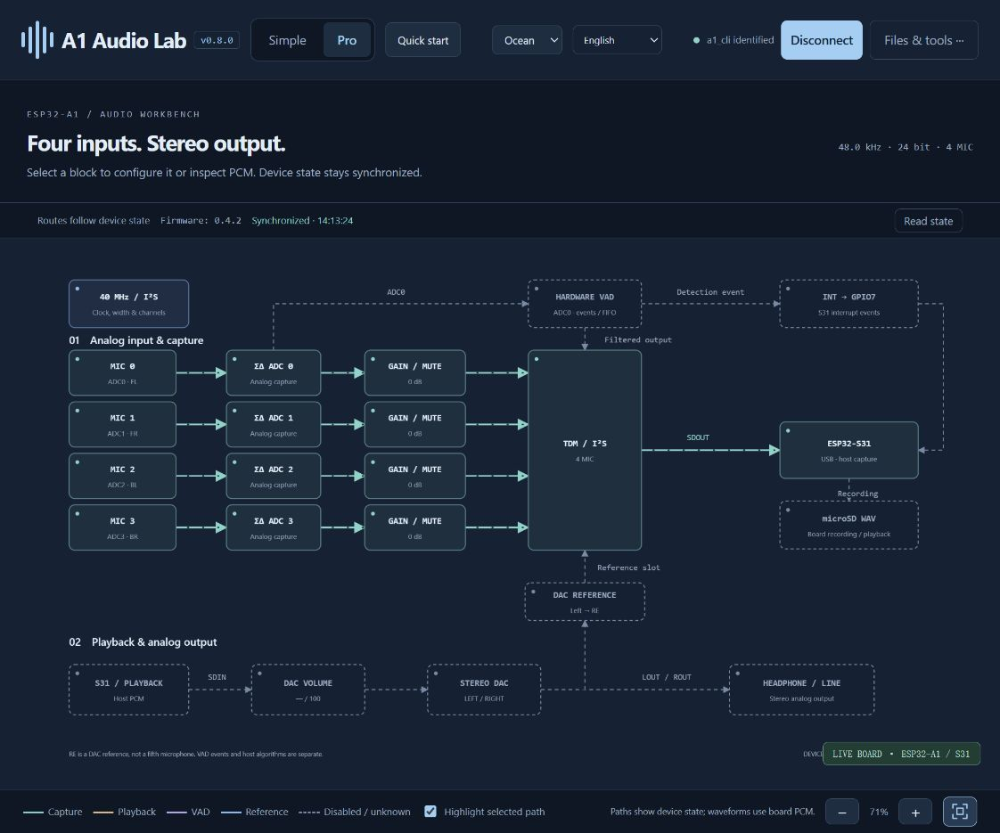
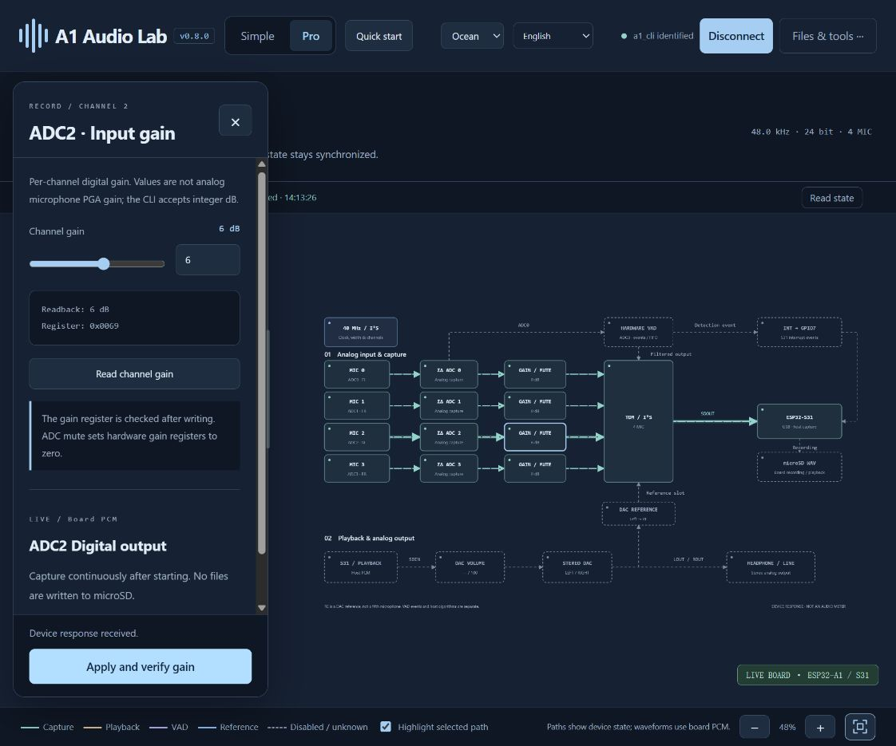
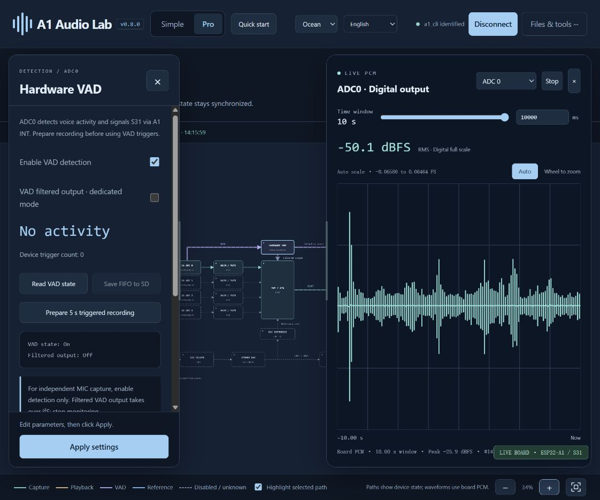
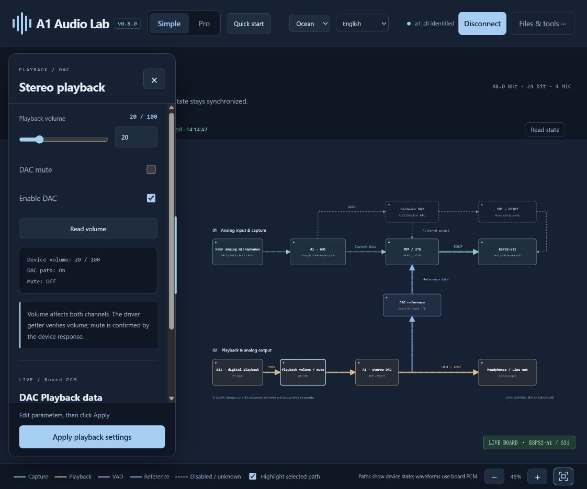
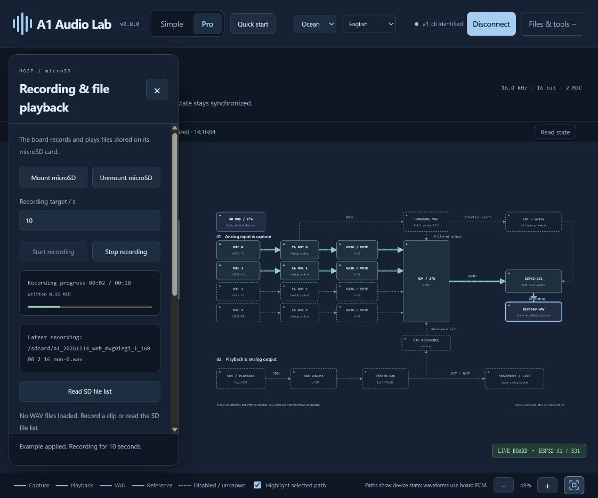
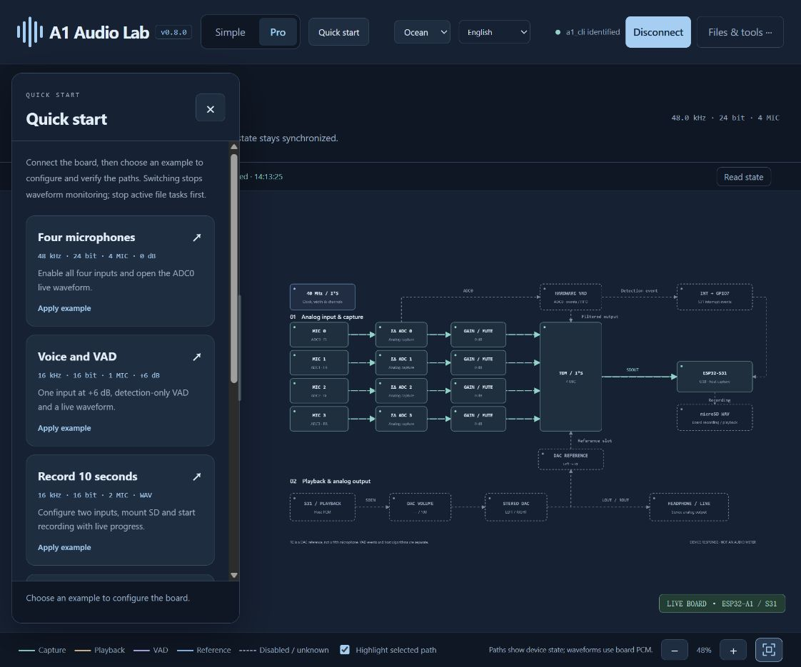

# ESP32-A1 / S31 board gallery · v0.8.0

[中文介绍](../README.md) · [English introduction](../README.en.md) · [Test record](validation-v0.8.0.md)

These images show web v0.8.0 connected to the ESP32-A1 Codec + ESP32-S31 EV Board running debug firmware v0.4.2. They retain the hardware evidence for that version; the current README separately shows the v0.8.2 interface with a simulated device.

## Four-channel capture

The professional diagram shows the four input channels, independent gain, TDM, host, playback and reference paths.

## ADC2 gain and live PCM

ADC2 is set to +6 dB and checked against register 0x0069. The same channel's PCM panel shows RMS, peak and the capture window.

## Detection-only VAD

Filtered output remains off, so the independent MIC stream continues while VAD status and events are read separately.

## Duplex and DAC reference

The playback row is spaced below capture. VAD filtered data enters TDM from above and the DAC reference returns from below.

## SD recording

The ten-second stereo recording finalized as 160000 frames and 640044 WAV bytes and passed the on-board full-file read. See the linked test record for the configuration.

## Quick-start examples

The examples apply settings in dependency order, verify responses and provide capture, VAD, recording, playback, duplex/reference and stop-all workflows.
